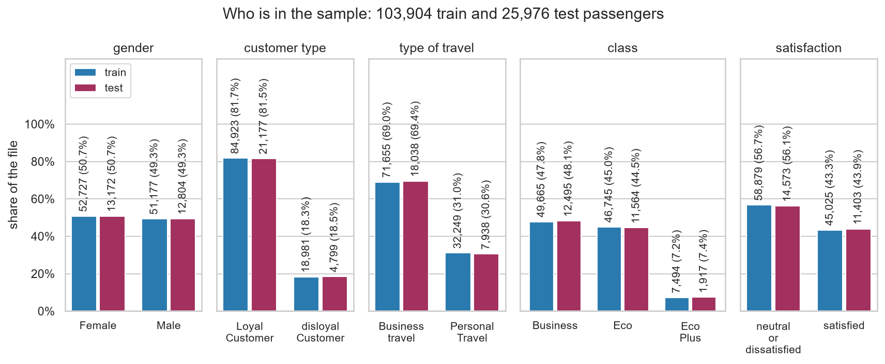
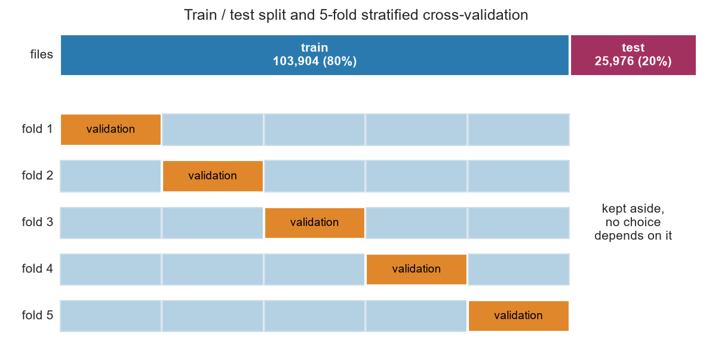

# Airline Passenger Satisfaction

Integrated Machine Learning project (UIR, 2026/2027), subject 12, group Argmax:
Imrane Moatadid, Houssam Jabar, Abderrafie Jaafari. Supervisor: Anas Knari.

**Task.** Binary classification: predict whether an airline passenger is *satisfied* or
*neutral or dissatisfied* from their profile, their trip and their ratings of 14 services,
and explain which services and characteristics drive satisfaction.

**Data.** [Airline Passenger Satisfaction](https://www.kaggle.com/datasets/teejmahal20/airline-passenger-satisfaction)
(Kaggle): 103,904 training and 25,976 test passengers, 22 features.

## Installation

```bash
python -m venv .venv            # Python 3.14 (version used for the saved model)
.venv\Scripts\activate          # Windows (Linux/macOS: source .venv/bin/activate)
pip install -r requirements.txt
```

The versions are pinned: `models/best_model.pkl` was saved with scikit-learn 1.9.1 and may not load
with another version.

## Get the data

```bash
python -m src.data
```

This downloads the public Kaggle dataset (no Kaggle account needed) and copies `train.csv` and
`test.csv` into `data/raw/`.

## Data and split

| | Train | Test |
|---|---|---|
| Passengers | 103,904 (80 %) | 25,976 (20 %) |
| Women / men | 52,727 / 51,177 | 13,172 / 12,804 |
| Satisfied | 45,025 (43.3 %) | 11,403 (43.9 %) |
| Duplicated passengers or rows | 0 | 0 |
| Missing values (arrival delay only) | 310 | 83 |
| Ratings equal to 0 | 15,932 | 4,202 |

- The train / test split is the one provided with the dataset; no passenger is in both files.
- There is no fixed validation file: models and hyperparameters are compared in **5-fold stratified cross-validation**
  on the train file (83,123 passengers to train, 20,781 to validate, five times). The preprocessing is learned on the
  training folds only.
- `data/raw/` is not versioned: the command above downloads both files.





## Train the models

```bash
python main.py                                   # all models (about 10 minutes on 8 cores)
python main.py --models logistic_regression lda  # only some models
```

`main.py` tunes each model of the course (logistic regression, KNN, LDA, QDA, decision tree,
random forest, gradient boosting) with a grid search in 5-fold stratified cross-validation, evaluates
the tuned models on the test set, and saves:

- `reports/results/model_results.csv`: chosen hyperparameters, cross-validation and test scores;
- `reports/figures/13_*` to `15_*`: model comparison, ROC curves, confusion matrix of the best model;
- `models/best_model.pkl`: the full pipeline (preprocessing + model) with the best cross-validation F1-score;
- `models/model_card.json`: its name, hyperparameters and scores.

## Predict new passengers

```bash
python test.py                              # example passengers in data/samples/new_passengers.csv
python test.py --input my_passengers.csv    # any CSV with the columns of the Kaggle files
```

`test.py` only loads `models/best_model.pkl`; it does not need the training data.

## Robustness experiments

```bash
python main.py --config configs/config_wide.yaml     # wider grids for the tree and the boosting
python main.py --config configs/config_nowifi.yaml   # selected boosting without the wifi = 0 flag
```

Their scores are in `reports/results_wide/` and `reports/results_nowifi/`. They write their own models and figures,
so the selected model is never overwritten.

## Results

Scores of the tuned models. No choice depends on the test file: models and hyperparameters are
selected in cross-validation on the training set. The test file is reused afterwards only to interpret the
selected model (notebook 02).

| Model | Train F1 | Validation F1 (± std of the 5 folds) | Test F1 | Test accuracy | Test ROC-AUC |
|---|---|---|---|---|---|
| **Gradient boosting (selected)** | 0.967 | **0.9577** ± 0.0013 | 0.958 | 0.964 | 0.995 |
| Random forest | 0.994 | 0.9554 ± 0.0020 | 0.957 | 0.963 | 0.994 |
| Decision tree | 0.969 | 0.9409 ± 0.0017 | 0.943 | 0.950 | 0.971 |
| KNN | 1.000 | 0.9215 ± 0.0024 | 0.925 | 0.935 | 0.981 |
| Logistic regression | 0.890 | 0.8897 ± 0.0037 | 0.890 | 0.903 | 0.966 |
| LDA | 0.886 | 0.8856 ± 0.0042 | 0.885 | 0.899 | 0.963 |
| QDA | 0.871 | 0.8703 ± 0.0036 | 0.868 | 0.887 | 0.954 |

Why gradient boosting: it has the best validation F1, it beats the random forest on each of the five folds (by 0.0023 on
average), and its train score is only 0.010 above its validation score, against 0.039 for the forest.

Main findings:

- Satisfaction is driven first by the **type of trip and loyalty**, then by the **digital experience**
  (online boarding, inflight wifi) and the **on-board services**; delays, gender and gate location barely matter.
- A rating of 0 is treated as **"not applicable"** (documented by Kaggle for wifi, our assumption for the other
  services): flagging it is the preprocessing step that matters (+3.5 F1 points
  for logistic regression in the ablation study); the other engineered features change the score by less
  than 0.1 point.
- Standardisation only matters for KNN (F1 0.866 without scaling, 0.904 with min-max, 0.909 with standardisation, on a
  sample of 20,000 passengers).
- Passengers with wifi "not applicable" are 99.7 % satisfied, which looks like a survey artifact: it is the main
  limitation of the dataset.
- Robustness (cross-validation F1 on the training set): wider grids bring nothing (0.9578 with 127 leaves, against
  0.9577 with 63, so the simpler model is kept), and removing the wifi flag costs 0.0018 (0.9559).

## Notebooks

- `notebooks/01_eda_feature_engineering.ipynb`: sample, data quality, train / validation / test split, exploration
  with figures, and the justification of each feature-engineering choice.
- `notebooks/02_modeling_and_interpretation.ipynb`: ablation study, comparison of scalings, train / validation / test
  scores, choice of the model, and interpretation (permutation importance, coefficients, a small tree, errors).
- `notebooks/03_wifi_pattern.ipynb`: who the passengers with a wifi rating of 0 are, and why their 99.7 %
  satisfaction looks like a survey artifact.

Open them with `jupyter notebook`. The figures are also saved in `reports/figures/`.

## Project structure

| Path | Purpose |
|---|---|
| `main.py` | Training entry point |
| `test.py` | Independent inference on new passengers |
| `configs/config.yaml` | Paths, column groups, feature-engineering steps, models and search spaces |
| `configs/config_wide.yaml`, `configs/config_nowifi.yaml` | Robustness experiments |
| `src/data.py` | Dataset download and loading |
| `src/preprocessing.py` | Feature engineering and representation pipeline |
| `src/model.py` | Model definitions and hyperparameter grids |
| `src/train.py` | Cross-validated hyperparameter search |
| `src/evaluate.py` | Metrics, comparison figures, permutation importance |
| `src/visualization.py` | Plotting functions of the exploratory analysis |
| `src/utils.py` | Configuration loading and paths |
| `data/samples/` | Example passengers for `test.py` |
| `models/` | Saved best model and its card |
| `reports/` | Figures and result tables |
